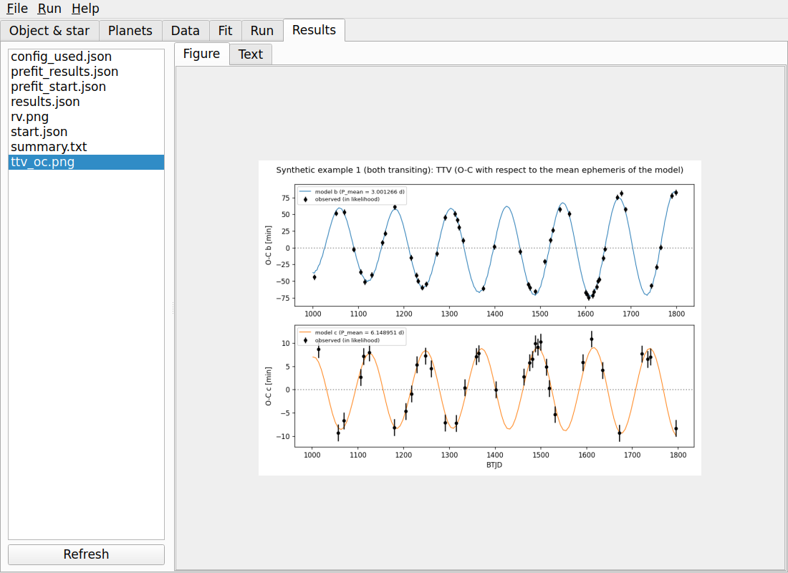

# photodyn2p

**A TTV and photodynamical model for two planets, with a graphical user interface.**

photodyn2p models two gravitationally interacting planets around one star. The orbits are integrated with the
N-body code [TTVFast](https://github.com/kdeck/TTVFast); from them the program predicts transit times, stellar
radial velocities and, in photodynamical mode, the light curve with every transit at its own predicted time.
Either planet may transit or not: a non-transiting planet is detected through the transit timing variations
(TTVs) it induces on the other planet and through the radial velocities.



## Features

- **Two modes**: `ttv` (mid-transit times + radial velocities; fast) and `photodyn` (light curves per segment,
  with an optional quasi-periodic Gaussian process for stellar activity, plus mid-times and radial velocities).
- **Prefit**: a global search (differential evolution) on a cheap objective, followed by least-squares
  polishing of the best distinct solutions; finds the right dynamical configuration in a strongly multimodal
  problem.
- **Maximum-likelihood fit** (L-BFGS-B in scaled coordinates, parallel gradients) and **MCMC** (emcee, with a
  resumable HDF5 back-end).
- **Graphical user interface** (PyQt5) that writes a JSON configuration and runs the core as a separate
  process; every run can be repeated from the command line.
- **Test examples with a known truth** (synthetic systems generated with the program's own physics) and a
  reference check against an independent analysis of TOI-3686.

## Installation

Python 3.7 or newer.

```bash
git clone https://github.com/svaverbe/photodyn2p.git
cd photodyn2p
python -m pip install -r requirements.txt
```

On Windows, run it in WSL (Windows 11 shows the GUI windows directly).

## Quick start

```bash
python photodyn2p_gui.py examples_synthetic/example1_ttv_both/config.json
```

On the **Run** tab set *Start file* to `truth_start.json`, press **Check: lnP at the start**, and the log should
end with `Start: lnP = 325.60`. Then follow the [user manual](photodyn2p_manual.pdf) (also under
*Help → User manual*, F1): it explains every tab, the prefit and the maximum-likelihood fit in full, walks
through four test examples, and gives a step-by-step recipe for a new object.

Without the GUI:

```bash
python photodyn2p.py examples_synthetic/example1_ttv_both/config.json --nproc 8
```

## Contents

| file | content |
|---|---|
| `photodyn2p.py` | computational core |
| `photodyn2p_gui.py` | graphical user interface |
| `photodyn2p_manual.pdf` | user manual with test examples |
| `make_synthetic_examples.py` | regenerates `examples_synthetic/` (known truth in `truth.json`) |
| `examples_synthetic/` | example 1 (ttv, both transiting), 2 (ttv, one planet non-transiting), 3 (photodyn) |
| `examples_toi3686/` | reference check against the TOI-3686 analysis (needs the TOI-3686 data, not included) |
| `tools/block_check.py` | convergence check of an MCMC back-end |
| `manual_src/` | source of the manual |
| `docs/` | project website (GitHub Pages) |

## Dependencies

numpy, scipy, matplotlib, [ttvfast](https://github.com/mindriot101/ttvfast-python),
[batman](https://github.com/lkreidberg/batman), [celerite2](https://github.com/exoplanet-dev/celerite2),
[emcee](https://github.com/dfm/emcee), h5py, PyQt5. Please cite TTVFast (Deck et al. 2014), batman
(Kreidberg 2015), celerite (Foreman-Mackey et al. 2017) and emcee (Foreman-Mackey et al. 2013) when you use
results of this program.
